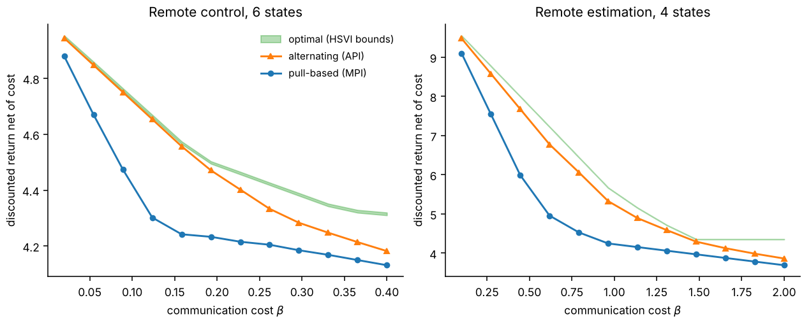
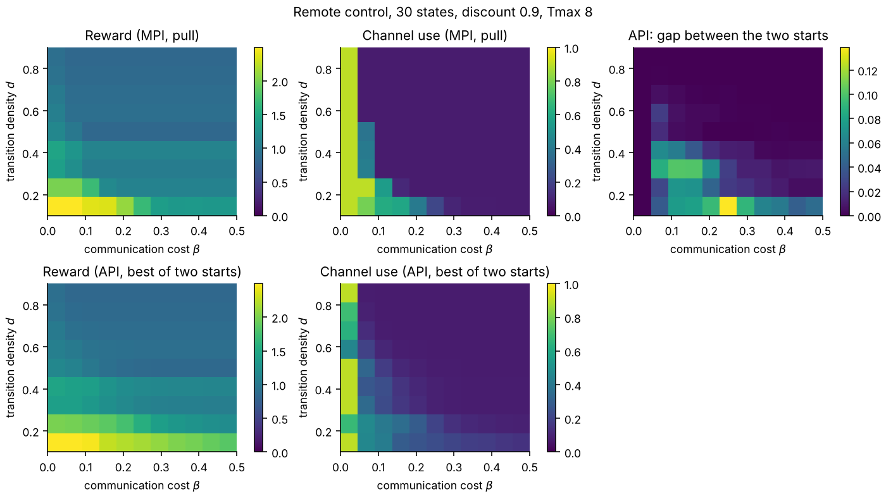
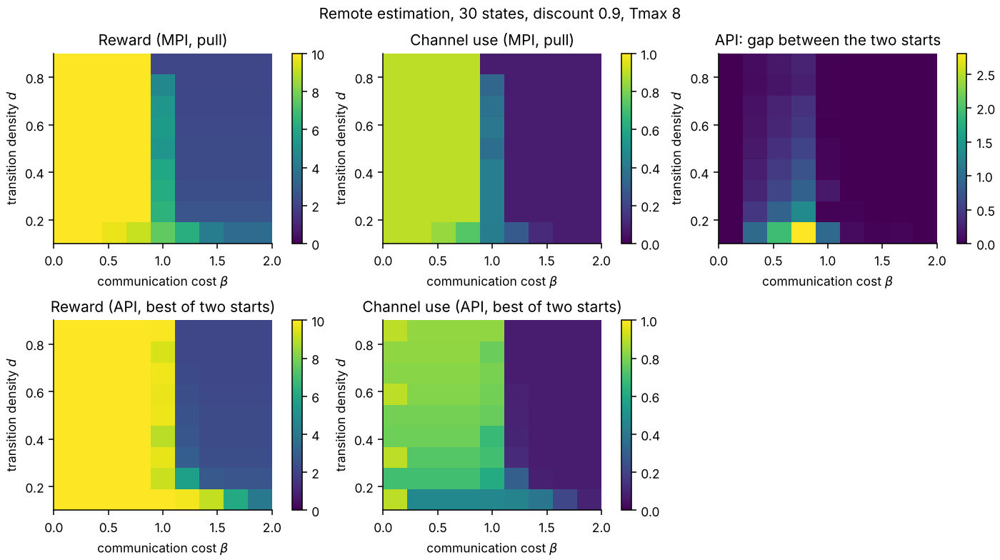

# Pragmatic communication for remote control

Solvers for the problem in *Pragmatic Communication for Remote Control of
Finite-State Markov Processes* (Talli, Santi, Chiariotti, Soleymani, Mason,
Zanella, Gündüz; [arXiv:2405.10672](https://arxiv.org/abs/2405.10672)).

An encoder sees a Markov process and pays a cost every time it sends the
current state. A decoder receives those updates and controls the process (or,
in the special case of remote estimation, tries to guess its state). The two
must decide *together* how often to communicate and what to do in between.

This repository implements three ways of solving it, with tests that check them
against exhaustive search, simulation and each other:

| Method | Module | What it gives you |
| --- | --- | --- |
| **Alternating** policy iteration (API) | `pragmatic_rc.push` | A Nash equilibrium of the encoder/decoder game. Fast, not always optimal. |
| **Optimal** joint policy (HSVI on the coordinator POMDP) | `pragmatic_rc.optimal` | An ε-optimal value with a certified lower and upper bound, and the policy that achieves it. |
| Pull-based modified policy iteration (MPI) | `pragmatic_rc.pull` | A policy for the case where only the decoder decides when to communicate. Reaches local optima, so use `restarts`. |

Edoardo David Santi contributed the alternating and optimal algorithms to the
paper. The paper's authors released their own code at
[pietro-talli/EffCom](https://github.com/pietro-talli/EffCom). This repository
is an independent implementation written for clarity and testing; the original
research code behind the alternating and optimal methods is in
[ed13santi/transmit-MDP-state](https://github.com/ed13santi/transmit-MDP-state).



The shaded band is the certified interval for the optimal value. The
alternating policy is close to optimal on the control task and loses more on
estimation, where silence carries more information. Part of the gap at high
cost comes from the truncation described under *Limitations*.

## Quick start

```bash
pip install -e ".[dev]"
pytest                      # about 30 s
python experiments/compare.py
```

```python
import numpy as np
from pragmatic_rc import optimal, push, random_estimation_mdp

mdp = random_estimation_mdp(n_states=4, density=0.5, gamma=0.9, rng=np.random.default_rng(1))
beta = 0.4  # cost per transmission

# Optimal: bounds on the best achievable return, within eps.
solution = optimal.solve(mdp, beta, eps=0.02)
print(solution.value_bounds)          # (lower, upper)

# Alternating: start the encoder from "never transmit" and iterate to equilibrium.
policy, evaluation = push.api(mdp, beta, t_max=8, c_init=push.never_transmit(8, 4))
print(evaluation.value(beta).mean())
```

## The model

Rewards are discounted by `gamma`. At every step the encoder decides whether to
send the current state, which costs `beta`. The decoder then picks a control
action based on what it knows. The very first state is revealed for free, so
every value in this repository is the expected return with a uniformly random
initial state that the decoder sees at time zero.

`MDP.P[a, s, s']` and `MDP.R[a, s, s']` are the transition probabilities and
rewards. Two benchmark families are provided:

* `random_control_mdp`: a random MDP with two reward peaks. A `density`
  parameter spreads each deterministic transition over neighbouring states.
* `random_estimation_mdp`: the decoder guesses the state and earns 1 if right.
  Guesses do not affect the dynamics.

## Why the solvers track beliefs, not just the time since the last update

It is tempting to describe the decoder's situation by `(delta, last state)`,
the time since the last update and the state it carried. That description is
not Markov when the decoder's actions affect the process. The decoder's belief
about the current state depends on *which actions it took* since the last
update, and on what silence has ruled out. A dynamic program over `(delta,
last state)` alone only makes sense if the action sequence is treated as part
of the policy.

* The pull-based solver handles this by making the decoder's plan an explicit
  action sequence after each update and computing beliefs from it.
* The alternating solver filters the belief with the encoder's current rule:
  silence removes the states in which the encoder would have transmitted.
* The optimal solver works directly on the belief, so neither the delay nor
  the action history needs to be tracked separately.

## The optimal method

A coordinator who sees only what the decoder sees can prescribe to the encoder
a set of states in which to transmit, and to the decoder an action. The belief
over the current state is a sufficient statistic for this coordinator, so the
two-agent problem becomes a single-agent POMDP. Each step has two phases: the
encoder's rule is chosen before anything is observed, and the decoder acts
after seeing whether a message arrived.

`optimal.solve` runs heuristic search value iteration. It keeps alpha-vector
lower bounds and sawtooth upper bounds for both phases and refines them along
the trajectories where the upper bound is most promising, until the gap at the
starting beliefs is at most `eps`.

The solver is checked three ways: bounds are ordered and within `eps`; the
bounds sit above the value of every alternating and pull-based policy; and the
extracted policy, executed by tracking the belief in simulation, earns a
return that matches the bounds.

## Results

Value of the best policy found by each method on small random problems (seed 1,
density 0.5, discount 0.9, `t_max` 8):

| Task | β | Optimal (bounds) | Alternating | Pull-based |
| --- | --- | --- | --- | --- |
| Estimation, 4 states | 0.1 | 9.53 – 9.55 | 9.48 | 9.10 |
| Estimation, 4 states | 0.4 | 8.20 – 8.22 | 7.91 | 6.40 |
| Control, 4 states | 0.4 | 7.27 – 7.27 | 6.97 | 6.97 |

In the control row the optimal policy never transmits after the first state, so
the gap to the other two is the price of their forced transmissions at `t_max`.

Larger grids over transition density and cost for the pull-based and
alternating methods on 30-state problems:




## What the tests check

* **Pull-based MPI against exhaustive search.** On small problems it enumerates
  every action sequence and compares. A single run reaches the optimum in
  about 60% of cases, so `pull.mpi` accepts `restarts`; the best of 20 starts
  reached it in 39 of 40 instances (`experiments/local_optima.py`).
* **Analytic values against simulation.** Policy evaluation for the pull-based
  and alternating solvers is compared with a Monte Carlo simulation that never
  computes a belief, including a case where silence is informative.
* **Alternating policy iteration is an equilibrium.** Neither player can gain
  by deviating, from both starting points.
* **Optimal against everything else.** See above.
* **Free channel.** With zero cost the optimal value equals full-information
  control.

## Limitations

* **Small state spaces.** The optimal solver enumerates all `2^S` transmission
  rules per belief, and the exploration is exponential in the worst case.
  It is a reference solver for problems of a handful of states.
* **Truncation in the alternating and pull-based solvers.** A transmission is
  forced after `t_max` silent steps. At high communication cost this makes them
  look worse than the optimal policy, which is allowed to stay silent forever.
* **Alternating policy iteration is only an equilibrium.** From different
  starting points it can end in different equilibria; `push.never_transmit` and
  `push.always_transmit` give two natural ones.
* **Not a line-by-line port of the paper's algorithms.** The pull-based
  improvement step is my reading of the paper's MPI and reaches local optima.
  The benchmark MDP construction follows Sec. VI of the paper but its
  coefficients differ from the closed form printed there. The paper's
  counterexample for the alternating scheme (Fig. 1) was not reproduced under
  these conventions. The paper's optimal scheme uses a point-based POMDP
  solver (SARSOP); this repository uses HSVI.
* **Conventions differ from the research code.** Here `P[a, s, s']` is
  row-stochastic and the objective is discounted. `transmit-MDP-state` uses
  column-stochastic matrices and an average-reward objective.

## Layout

```
src/pragmatic_rc/
    mdp.py        MDP container and the two benchmark generators
    pull.py       pull-based MPI, exact evaluation, exhaustive-search reference
    push.py       alternating policy iteration, exact evaluation
    optimal.py    coordinator POMDP and HSVI, policy execution
    simulate.py   Monte Carlo simulators for the pull and push policies
experiments/      scripts that regenerate every figure
tests/            36 tests
```

## Citation

```bibtex
@article{talli2024pragmatic,
  title   = {Pragmatic Communication for Remote Control of Finite-State Markov Processes},
  author  = {Talli, Pietro and Santi, Edoardo David and Chiariotti, Federico and
             Soleymani, Touraj and Mason, Federico and Zanella, Andrea and G{\"u}nd{\"u}z, Deniz},
  journal = {arXiv preprint arXiv:2405.10672},
  year    = {2024}
}
```

Licensed under Apache 2.0.
