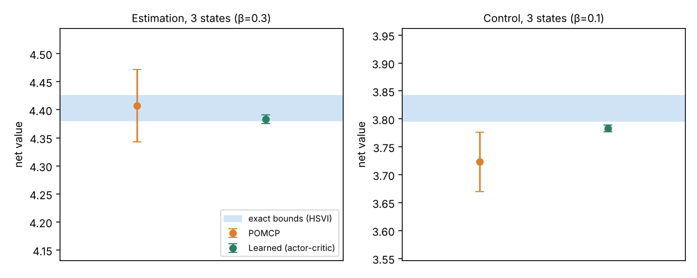
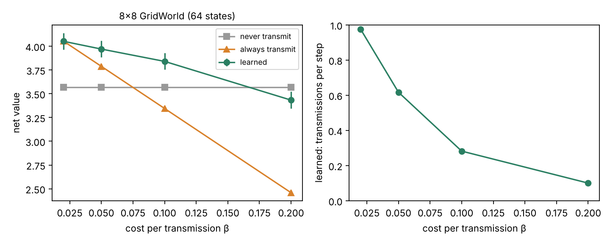
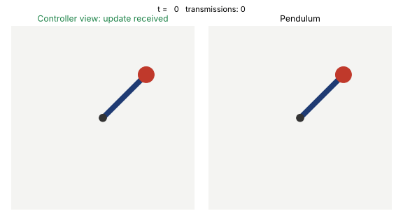
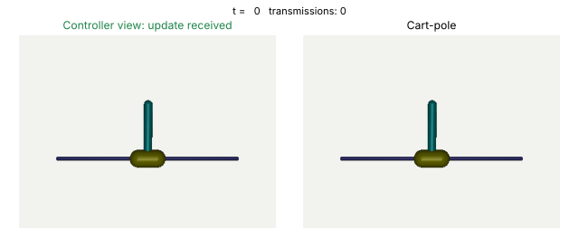
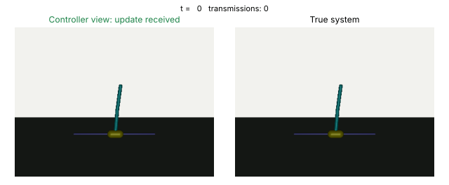
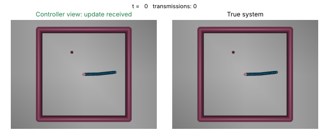
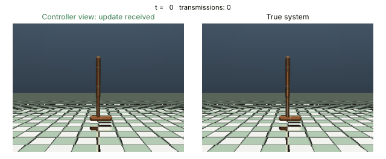
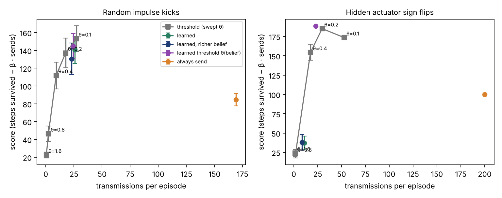

# Pragmatic communication for remote control

Solvers for the problem in *Pragmatic Communication for Remote Control of
Finite-State Markov Processes* (Talli, Santi, Chiariotti, Soleymani, Mason,
Zanella, Gündüz; [arXiv:2405.10672](https://arxiv.org/abs/2405.10672)).

An encoder sees a Markov process and pays a cost every time it sends the
current state. A decoder receives those updates and controls the process (or,
in the special case of remote estimation, tries to guess its state). The two
must decide *together* how often to communicate and what to do in between.

This repository implements three ways of solving it, with tests that check them
against exhaustive search, simulation and each other:

| Method | Module | What it gives you |
| --- | --- | --- |
| **Alternating** policy iteration (API) | `pragmatic_rc.push` | A Nash equilibrium of the encoder/decoder game. Fast, not always optimal. The decoder step is an exact best response; in control that takes a search over action sequences. |
| **Optimal** joint policy (HSVI on the coordinator POMDP) | `pragmatic_rc.optimal` | An ε-optimal value with a certified lower and upper bound, and the policy that achieves it. |
| **POMCP** on the coordinator POMDP | `pragmatic_rc.pomcp` | Sampling-based planning for state spaces too large for the exact solver. Needs only a simulator; searches a restricted family of encoder rules. |
| **Learned policies** (actor-critic) | `pragmatic_rc.neural` | The encoder's prescription is a network of (belief summary, true state). No enumeration of subsets; no optimality certificate. Needs PyTorch. |
| Pull-based modified policy iteration (MPI) | `pragmatic_rc.pull` | A policy for the case where only the decoder decides when to communicate. Reaches local optima, so use `restarts`. |

Edoardo David Santi contributed the alternating and optimal algorithms to the
paper. The paper's authors released their own code at
[pietro-talli/EffCom](https://github.com/pietro-talli/EffCom). This repository
is an independent implementation written for clarity and testing; the original
research code behind the alternating and optimal methods is in
[ed13santi/transmit-MDP-state](https://github.com/ed13santi/transmit-MDP-state).


The shaded band is the certified interval for the optimal value. The
alternating policy is close to optimal on the control task and loses more on
estimation, where silence carries more information. Part of the gap at high
cost comes from the truncation described under *Limitations*.

## Quick start

```bash
pip install -e ".[dev]"
pytest                      # about 30 s
python experiments/compare.py   # about 10 min, dominated by the optimal solver
```

```python
import numpy as np
from pragmatic_rc import optimal, push, random_estimation_mdp

mdp = random_estimation_mdp(n_states=4, density=0.5, gamma=0.9, rng=np.random.default_rng(1))
beta = 0.4  # cost per transmission

# Optimal: bounds on the best achievable return, within eps.
solution = optimal.solve(mdp, beta, eps=0.02)
print(solution.value_bounds)          # (lower, upper)

# Alternating: start the encoder from "never transmit" and iterate to equilibrium.
policy, evaluation = push.api(mdp, beta, t_max=8, c_init=push.never_transmit(8, 4))
print(evaluation.value(beta).mean())
```

## The model

Rewards are discounted by `gamma`. At every step the encoder decides whether to
send the current state, which costs `beta`. The decoder then picks a control
action based on what it knows. The very first state is revealed for free, so
every value in this repository is the expected return with a uniformly random
initial state that the decoder sees at time zero.

`MDP.P[a, s, s']` and `MDP.R[a, s, s']` are the transition probabilities and
rewards. Two benchmark families are provided:

* `random_control_mdp`: a random MDP with two reward peaks. A `density`
  parameter spreads each deterministic transition over neighbouring states.
* `random_estimation_mdp`: the decoder guesses the state and earns 1 if right.
  Guesses do not affect the dynamics.

## Why the solvers track beliefs, not just the time since the last update

It is tempting to describe the decoder's situation by `(delta, last state)`,
the time since the last update and the state it carried. That description is
not Markov when the decoder's actions affect the process. The decoder's belief
about the current state depends on *which actions it took* since the last
update, and on what silence has ruled out. A dynamic program over `(delta,
last state)` alone only makes sense if the action sequence is treated as part
of the policy.

* The pull-based solver handles this by making the decoder's plan an explicit
  action sequence after each update and computing beliefs from it.
* The alternating solver filters the belief with the encoder's current rule:
  silence removes the states in which the encoder would have transmitted.
  Against a fixed encoder the decoder's best response is an MDP over
  `(delta, last state)` **only in remote estimation**, where its actions do not
  move the process. In control it is a search over action sequences, so
  `push.decoder_best_response` enumerates them (exponential in `t_max`).
  Greedy policy iteration over `(delta, last state)` is available as a
  fallback for larger problems but can stop at a worse policy: on random
  4-state control tasks it was not a best response in 3 of 40 runs, with a
  decoder value up to 0.11 below the best.
* The optimal solver works directly on the belief, so neither the delay nor
  the action history needs to be tracked separately.

## The optimal method

A coordinator who sees only what the decoder sees can prescribe to the encoder
a set of states in which to transmit, and to the decoder an action. The belief
over the current state is a sufficient statistic for this coordinator, so the
two-agent problem becomes a single-agent POMDP. Each step has two phases: the
encoder's rule is chosen before anything is observed, and the decoder acts
after seeing whether a message arrived.

`optimal.solve` runs heuristic search value iteration. It keeps alpha-vector
lower bounds and sawtooth upper bounds for both phases and refines them along
the trajectories where the upper bound is most promising, until the gap at the
starting beliefs is at most `eps`.

The solver is checked three ways: bounds are ordered and within `eps`; the
bounds sit above the value of every alternating and pull-based policy; and the
extracted policy, executed by tracking the belief in simulation, earns a
return that matches the bounds.

## POMCP for large state spaces

`optimal.solve` is exact but limited to a handful of states. `pragmatic_rc.pomcp`
runs Monte Carlo tree search (POMCP) on the same two-phase coordinator POMDP and
only needs a simulator (`envs.Simulator`: `sample_initial`, `step`, `features`).
Two ingredients make it work here:

* **Encoder rule families.** The encoder cannot choose an arbitrary subset of a
  huge state space, so the planner picks among rules such as "transmit if the
  state is further than `theta` from the decoder's belief mean"
  (`DistanceFromMean`) or "transmit if the decoder gives it mass below `theta`"
  (`BeliefMassThreshold`). The result is a lower bound on the optimum.
  `AllSubsets` recovers the full problem on tiny instances.
* **Shared renewal nodes.** A transmission makes the belief a point mass, so every
  history ending in the same transmitted state shares one subtree.

On a 3-state estimation problem POMCP with `AllSubsets` reaches 4.41 ± 0.03
against certified bounds of 4.38 – 4.43. `envs.GridWorld(n)` gives a state space
that grows as `n²`. Continuous states (MuJoCo) would additionally need
discretised observations or progressive widening, which is not implemented.

### Learned encoder and decoder

The rule families above are hand-designed. `pragmatic_rc.neural` instead learns
the prescription: a network maps a summary of the decoder's belief (particle mean
and spread, time since the last update) and the encoder's true state to a send
probability, and a second network picks the control action. The subset of states
in which the encoder sends is never enumerated, only evaluated at the current
state. Silence stays informative: after a silent step each particle is reweighted
by the probability the encoder would have stayed quiet. Both networks are trained
jointly by actor-critic with a critic that sees the true state.

On the same 3-state problems the learned policies reach 4.38 ± 0.004 (estimation,
bounds 4.38 – 4.43) and 3.78 ± 0.003 (control, bounds 3.80 – 3.84), in under a
minute of CPU. The control result is slightly below the exact lower bound, a
reminder that there is no certificate once the policy is learned.
`pip install -e ".[neural]"` to use it.



### A grid with 64 states

`experiments/large.py` runs the learned policies on an 8×8 slippery GridWorld
(64 states, far beyond the exact solver) and compares them with never
transmitting (best decoder trained alone) and always transmitting (exact).



The learned policy beats both baselines at moderate cost and transmits less as
the cost grows (98%, 62%, 28%, 10% of steps for β = 0.02, 0.05, 0.1, 0.2). At
β = 0.2 it ends *below* never-transmit (3.43 against 3.57), which a better
optimiser would not: staying silent is always available. That is a training
shortfall, not a property of the problem, and the result there should be read as
a lower bound.

### PPO on a noisy pendulum

`pragmatic_rc.pendulum` wraps the coordinator problem as a Gymnasium environment
and `pragmatic_rc.ppo` trains it with Stable-Baselines3 PPO. A single network
plays both roles. Each time step is two decisions (control, then send or stay
silent), the observation says which one is due, and the true state is hidden from
the network in the control phase so that execution stays decentralised. The
decoder's belief is a particle filter that reweights particles by the probability
the encoder would have stayed silent, using the policy being trained. The
pendulum is the standard swing-up task with process noise on the angular velocity.



Left: what the controller sees, which is black whenever no update arrives. Right:
the pendulum. Total cost over 100 steps (pendulum cost plus 0.3 per transmission,
lower is better, 100 episodes, 1M PPO decisions each, one seed):

| Policy | Cost | Transmissions per episode |
| --- | --- | --- |
| Never transmit (controller trained alone) | 565 ± 8 | 0 |
| Always transmit (controller trained alone) | 240 ± 13 | 100 |
| Joint (learns when to send) | 243 ± 13 | 73 |

At this cost the joint policy reaches the same total as always transmitting
while sending 27% less often, so it is not yet doing better.

At higher cost, with twice the training (2M decisions), it clearly economises:

| β | Joint cost | Joint transmissions | Always transmit (estimated) | Never transmit |
| --- | --- | --- | --- | --- |
| 1.0 | 267 ± 11 | 26 | about 310 | 565 ± 8 |
| 3.0 | 330 ± 10 | 24 | about 510 | 565 ± 8 |

The "always" column is not a separate run: it is the 210 control cost measured at
β = 0.3 plus β per transmission. One seed throughout, a small network and no
tuning, so treat these as a working pipeline rather than a result about the
method. There is no exact solution to compare against.
`pip install -e ".[ppo]"`; `python experiments/pendulum.py joint`.

### MuJoCo cart-pole

`pragmatic_rc.mujoco_env` applies the same construction to Gymnasium's MuJoCo
InvertedPendulum model: keep the pole up, earning 1 per step, with the episode
ending when it falls. Randomness comes from noise on the actuator, which the real
system and every belief particle experience. All particles advance in a single
`mujoco.rollout` call. The pole is unstable, so the controller cannot go long
without information.



Score is steps survived out of 200 minus 0.5 per transmission (higher is better,
100 episodes, 1M PPO decisions each, one seed):

| Policy | Score | Transmissions per episode |
| --- | --- | --- |
| Never transmit (controller trained alone) | 14 ± 1 | 0 |
| Always transmit (controller trained alone) | 100 | 200 |
| Joint (learns when to send) | 185 ± 2 | 22 |

Without updates the pole falls within about 14 steps. Transmitting every step
keeps it up but pays for 200 messages. The joint policy keeps the pole up almost
as reliably with about one message in nine. One seed, no tuning, and no exact
solution to compare against. `pip install -e ".[mujoco]"`;
`python experiments/mujoco_pendulum.py joint`.

### Three more MuJoCo tasks

`pragmatic_rc.mujoco_env` is task-configurable (Gymnasium's v5 models and rewards).
MuJoCo is deterministic, so the only randomness is Gaussian noise I add to the
actuators, which the real system and every belief particle share; without it the
decoder could simulate the system exactly and nothing would need sending. The
noise levels and transmission costs below are my own choices, not a standard
benchmark. Score is the task's return minus β per transmission (higher is better;
50 episodes, one seed each).

| Task | Actuator noise | β | Joint (learns when to send) | Always transmit | Never transmit |
| --- | --- | --- | --- | --- | --- |
| Double pendulum, 200 steps, 1M decisions | 0.15 | 3.0 | **1539 ± 47** (68 sends) | 1271 (200) | 96 ± 3 |
| Reacher, 50 steps, 0.6M decisions | 0.3 | 0.05 | **−7.3 ± 0.4** (3.4 sends) | −8.3 ± 0.3 (50) | −8.6 ± 0.3 |
| Hopper, up to 200 steps, 1.5M decisions | 0.3 | 0.5 | **564 ± 11** (13 sends) | 465 ± 3 (165) | 162 ± 7 |





The joint policy beats both baselines on all three while sending far less often.
Two caveats. On Reacher the two baselines are close, because a stable arm loses
accuracy gradually when it hears nothing, so the task only weakly needs
communication at this noise level. On Hopper the belief particles stay tightly
bunched under this noise, so it is the least informative of the three about the
value of communicating. In the Hopper and always-transmit rows, episodes can end
early when the hopper falls (always transmit averages 165 steps).
`python experiments/mujoco_task.py hopper joint 0.5 1500000` reproduces a row.

### When do threshold encoders suffice? Jumps and hidden modes

Threshold rules (send when the state is far from the decoder's belief) are the
standard event-triggered design, and for smooth dynamics they are often optimal.
Two cart-pole variants test whether jumps break that: random impulse kicks to the
cart velocity, and a hidden actuator sign that flips at random (the controller
must find out when its commands have reversed). Three families of encoder are
compared, all with a learned controller:

* a **fixed threshold** on the largest feature error against the belief mean, swept over θ;
* a **learned binary send policy**, with and without a richer belief summary
  (10% and 90% quantiles);
* a **learned state-dependent threshold**: the policy picks θ from the belief alone
  at every step, and the encoder sends when its error exceeds it. The coordinator's
  action is one number rather than a function over states, and the belief update is exact because the rule is known.



Score is steps survived out of 200 minus 0.5 per transmission (higher is better;
50 episodes, 500k PPO decisions, one seed).

| Encoder | Sign flips | Kicks |
| --- | --- | --- |
| Always send | 100 (200 sends) | 85 ± 4 (169) |
| Learned binary send policy | 37 ± 4 (11) | 141 ± 8 (26) |
| Best fixed threshold | 185.2 ± 0.2 (30), θ = 0.2 | 153 ± 7 (27), θ = 0.1 |
| Learned θ(belief) | **188.5 ± 0.2** (23) | 145 ± 7 (24) |

What this shows: the threshold parametrisation is much easier to learn than the
unstructured binary policy, which failed on the sign-flip task. A state-dependent
threshold edges out the best fixed one there and is within noise of it on kicks.
I did not find a task where thresholds fail: a kick or a flip produces a large
error that the rule detects. One seed, so the small differences are not
established. Reproduce with `experiments/run_jumps.sh` and
`experiments/run_threshold_learned.sh`.

## Results

Value of the best policy found by each method on small random problems (seed 1,
density 0.5, discount 0.9, `t_max` 8):

| Task | β | Optimal (bounds) | Alternating | Pull-based |
| --- | --- | --- | --- | --- |
| Estimation, 4 states | 0.1 | 9.53 – 9.55 | 9.48 | 9.10 |
| Estimation, 4 states | 0.4 | 8.20 – 8.22 | 7.91 | 6.40 |
| Control, 4 states | 0.4 | 7.27 – 7.27 | 6.97 | 6.97 |

In the control row the optimal policy never transmits after the first state, so
the gap to the other two is the price of their forced transmissions at `t_max`.

Larger grids over transition density and cost for the pull-based and
alternating methods on 30-state problems:


## What the tests check

* **Pull-based MPI against exhaustive search.** On small problems it enumerates
  every action sequence and compares. A single run reaches the optimum in
  about 60% of cases, so `pull.mpi` accepts `restarts`; the best of 20 starts
  reached it in 39 of 40 instances (`experiments/local_optima.py`).
* **Analytic values against simulation.** Policy evaluation for the pull-based
  and alternating solvers is compared with a Monte Carlo simulation that never
  computes a belief, including a case where silence is informative.
* **The decoder step is a best response.** Compared with an independent
  exhaustive search over action sequences, in control and in estimation. A
  regression test pins down a control case where the greedy step fails.
* **Alternating policy iteration is an equilibrium.** Neither player can gain
  by deviating, from both starting points, with the decoder's deviation
  checked by exhaustive search.
* **Optimal against everything else.** See above.
* **Free channel.** With zero cost the optimal value equals full-information
  control.

## Limitations

* **Small state spaces (exact solver).** The optimal solver enumerates all `2^S` transmission
  rules per belief, and the exploration is exponential in the worst case.
  It is a reference solver for problems of a handful of states.
* **Truncation in the alternating and pull-based solvers.** A transmission is
  forced after `t_max` silent steps. At high communication cost this makes them
  look worse than the optimal policy, which is allowed to stay silent forever.
* **Alternating policy iteration is only an equilibrium.** From different
  starting points it can end in different equilibria; `push.never_transmit` and
  `push.always_transmit` give two natural ones.
* **The exact decoder step has a size limit.** In control it searches
  `A ** t_max` action sequences per last state. Beyond 20,000 it falls back to
  the greedy step and the equilibrium guarantee no longer holds. Remote
  estimation is unaffected, since the greedy step is exact there.
* **Not a line-by-line port of the paper's algorithms.** The pull-based
  improvement step is my reading of the paper's MPI and reaches local optima.
  The benchmark MDP construction follows Sec. VI of the paper but its
  coefficients differ from the closed form printed there. The paper's
  counterexample for the alternating scheme (Fig. 1) was not reproduced under
  these conventions. The paper's optimal scheme uses a point-based POMDP
  solver (SARSOP); this repository uses HSVI.
* **Conventions differ from the research code.** Here `P[a, s, s']` is
  row-stochastic and the objective is discounted. `transmit-MDP-state` uses
  column-stochastic matrices and an average-reward objective.

## Layout

```
src/pragmatic_rc/
    mdp.py        MDP container and the two benchmark generators
    pull.py       pull-based MPI, exact evaluation, exhaustive-search reference
    push.py       alternating policy iteration, exact evaluation
    optimal.py    coordinator POMDP and HSVI, policy execution
    simulate.py   Monte Carlo simulators for the pull and push policies
    pomcp.py      POMCP planner with encoder rule families
    neural.py     learned encoder/decoder (actor-critic, PyTorch)
    pendulum.py   noisy pendulum as a Gymnasium environment, GIF renderer
    ppo.py        Stable-Baselines3 PPO training and evaluation
    mujoco_env.py MuJoCo tasks as Gymnasium environments, GIF renderer
    envs.py       simulators for sampling-based planning (tabular, GridWorld)
experiments/      scripts that regenerate every figure
tests/            55 tests
```

## Citation

```bibtex
@article{talli2024pragmatic,
  title   = {Pragmatic Communication for Remote Control of Finite-State Markov Processes},
  author  = {Talli, Pietro and Santi, Edoardo David and Chiariotti, Federico and
             Soleymani, Touraj and Mason, Federico and Zanella, Andrea and G{\"u}nd{\"u}z, Deniz},
  journal = {arXiv preprint arXiv:2405.10672},
  year    = {2024}
}
```

Licensed under Apache 2.0.

### Longer training on the sign-flip task

The binary learned policy scored 37 after 500k steps. After 3M steps it scores 184.9 (entropy bonus 0.01: 180.2), matching the fixed threshold (185) and close to the learned state-dependent threshold (188.5). The earlier gap came from under-training, not from the policy class.

### Seeds on the sign-flip task (3M steps, score out of 200)

| Method | Seed 0 | Seed 1 | Seed 2 |
|---|---|---|---|
| Learned threshold | 188.5 | 187.1 | 188.5 |
| General policy (send/no-send) | 184.9 | 167.2 | n/a |
| General policy + distance input | 128.0 | 142.1 | 173.2 |

The learned threshold is reliable across seeds. The general policy matches it on some seeds but needs about 10x more samples and varies between seeds. Giving it the distance as an input did not speed up learning.
